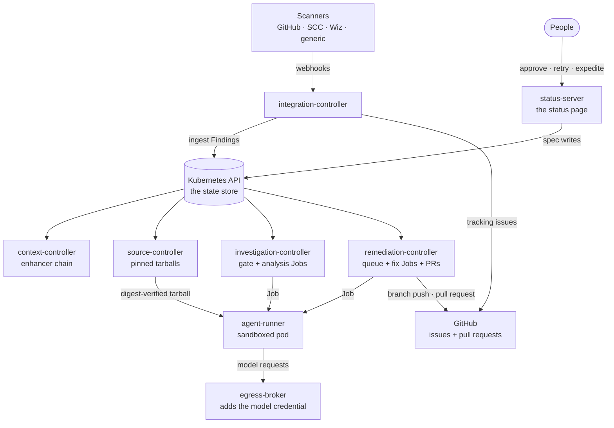

# How it works

Patchy is a set of Go binaries sharing one source of truth: the Kubernetes API. The `patchy.bitwisemedia.uk/v1alpha1`
custom resources carry all pipeline state: `Integration` and `Forge` (configuration), `Finding`, `Repository`,
`Investigation` and `Remediation` (the pipeline), `FindingRollup` (the all-time statistics), and the optional
`Evaluation` and `EvaluationUnit` ([remote evaluation](evaluation.md)). etcd is the only state store; there is no shadow
database or queue. GitHub issues are a **one-way, human-facing projection**: labels and comments are rendered from the
Finding, and human actions flow back in as spec writes, never by re-parsing issue state.

Webhooks enter through one door, the **integration-controller**. It serves one route per provider (`/github/webhooks`,
`/google-cloud/webhooks`, `/wiz/webhooks`, and `/generic/<name>/webhooks` for your own scanners) and validates each
delivery against the secrets of your configured `Integration` resources. No other component faces the scanners. Pipeline
progress is **not** webhook-driven: the gates ("accumulation closed", "older than an hour", "a free remediation slot")
are conditions no event can announce, so the controllers' watch-driven reconcile loops carry the pipeline. The webhook
path is ingestion and human-in-the-loop signals only.



Each agent pod reports back to the controller that launched it as a `PATCHY-EVENT:` stream on stdout; it never calls the
Kubernetes API or GitHub itself.

The components:

| Component                | Role                                                                                      |
| ------------------------ | ----------------------------------------------------------------------------------------- |
| integration-controller   | Webhooks in, Findings ingested, tracking issues projected, human signals applied          |
| source-controller        | Forge credentials validated, repositories pinned, tarballs served to agent pods           |
| context-controller       | The enhancer chain: ownership and infrastructure context                                  |
| investigation-controller | The gate, analysis agent Jobs, verdict routing                                            |
| remediation-controller   | The priority queue, remediation agent Jobs, branch push and pull request, rollups and TTL |
| agent-runner             | The in-pod coding-agent runtime (`claude -p` or `codex exec`)                             |
| egress-broker            | The proxy every agent model request goes through; it holds the model credential           |
| status-server            | The [status page](../operate/status-page.md): findings, metrics and human actions         |
| `patchy`                 | The [workstation CLI](../operate/cli.md): the same view and actions from a terminal       |
| evaluation-controller    | Optional: runs evolve's [remote evaluations](evaluation.md) on the same sandbox           |

Two namespaces, and the split is the security boundary. The controllers, the broker and the status server run in
`patchy` as single replicas. The ephemeral agent Jobs run in `patchy-agents`, which holds no credential at all: claude
and codex model traffic authenticates at the broker. See the [isolation model](isolation.md).

## 1. Findings arrive and accumulate

The **integration-controller** validates each scanner delivery (a GitHub `code_scanning_alert`, an SCC notification, a
Wiz issue, or a generic integration's finding; see [Integrations](../integrations/index.md)) and hands it to the
matching [`pkg/source` handler](../extending.md), which normalizes the alert into advisories (GHSA/CVE/CWE), severity,
and locations or cloud resources. The result is folded into a `Finding` resource: a new one at phase `Opened` for a
first alert, or — for the **accumulation window** (one hour by default) — merged into the existing Finding for the same
repository and advisory family. Accumulation is a condition (`AccumulationComplete`), not a phase, so alerts keep
folding in while enhancement runs concurrently. Alerts arriving after the window close open a fresh Finding.

## 2. The tracking issue is a projection

The same controller projects every Finding out as a GitHub tracking issue — body, enrichment and report comments, and a
trimmed [label vocabulary](issue-labels.md) (source, advisories, phase, severity, priority, recommendation). The
projection is one-way: nothing ever parses issue state back into the pipeline. Human signals do flow back: an issue
closed by a human hands the finding off, a `/approve` comment records an approval, and the PR merge webhook completes
it.

## 3. Context before code

The **context-controller** watches for `Opened` findings and runs the enhancer chain. Ownership and infrastructure
context is recorded as enrichments on Finding status (projected as issue comments by the integration-controller), then
the finding moves `Opened → Enhanced`. The chain runs in a fixed order, and each entry stands aside unless an
Integration enables it:

1. The cloud lookups: [Google Cloud Asset Inventory](../integrations/enhancers/google-cai.md),
   [AWS resource tags](../integrations/enhancers/aws.md) and [Azure resource tags](../integrations/enhancers/azure.md).
   For a cloud finding they also resolve the owning repository from labels on the resource.
2. The [generic HTTP fan-out](../integrations/enhancers/generic.md): one signed call to each generic Integration with
   enhancement on.
3. The static context file, a YAML map that stands in for a CMDB.

The context-controller has no GitHub access at all. Its only outbound calls are the lookups your Integrations enable.
The [`pkg/enhance`](../extending.md) seam takes further enhancers.

## 4. Repositories are pinned once

The **source-controller** runs the `Forge` and `Repository` reconcilers: it validates forge credentials, resolves each
Repository to its covering `Forge`, pins the head SHA exactly once, downloads the tarball archive at that SHA over plain
HTTP (no git binary anywhere controller-side), and serves it from an in-cluster artifact endpoint (`:9790`). Agent pods
fetch it **credential-lessly** — the URL carries an unguessable id and the Job pins the sha256 digest — so investigation
and remediation are guaranteed the same code.

## 5. The gate, then the investigation

The **investigation-controller** admits findings that are `Enhanced`, have a closed accumulation window, and are older
than `--finding-min-age` (one hour) — the age gate is the design's patience. Admission materializes the `Repository` and
one immutable `Investigation` per attempt (the child create is the lease), then the analysis scheduler runs agent Jobs
under bounded concurrency in severity order.

Inside the pod, **agent-runner** drives the model's harness (`claude -p` or `codex exec`, whichever the model's provider
needs) over the pinned tree and a templated finding handoff. The agent writes a report with parseable YAML frontmatter:
`exploitability`, `likelihood`, and `impact` ratings, a `recommendation` (`ignore` | `remediate` | `manual`),
`severity`, `priority`, a `confidence` value in [0, 1], and — for `remediate` — the model it wants for the fix (clamped
later to an operator allowlist) and its **estimate** of the turns and tokens the fix will take. The estimate never
shrinks the run: every remediation gets at least the operator's auto budget. Estimating _above_ it holds the finding for
human approval, and approving grants the larger budget, up to the manual budget (see
[the remediation budget](../deployment/models.md#the-remediation-budget)). Backwards-compatible fixes are always
favoured; if a better-but-breaking fix exists, the report says so and the pipeline holds the same way. The runtime never
talks to GitHub or the Kubernetes API — results leave the pod as a `PATCHY-EVENT:` JSONL stream on stdout.

## 6. Verdicts route

The investigation-controller stamps the results onto the Finding (the report is projected onto the tracking issue, and
the ratings feed a 0–100 scheduling priority) and routes on the verdict. A false positive (`ignore`) is dismissed and
its issue closed; `manual` work is handed to the repository owners; a confident `remediate` is queued; a `remediate`
below the confidence threshold, or one with a breaking change on offer, waits for a human approval. A failed stage is
retried within `--max-attempts`, then the finding fails; a partial report is never trusted. The full table is in
[Verdict routing](lifecycle.md#verdict-routing).

## 7. Remediation in priority order

The **remediation-controller** admits queued findings (including approvals and revivals), schedules them in priority
order under bounded concurrency (with aging so low-priority findings cannot starve), and runs the second agent stage:
the finding markdown, the same pinned tree, and the investigation report, under the budget the spawner granted. The
agent emits a summary report plus a `commit.sh` that must run cleanly and leave real commits — the claim is verified,
not believed.

The controller — the only holder of a forge **write** credential — then replays the changeset through the GitHub Git
Data API (blob → tree → commit → ref) onto a `patchy/<finding>` branch, opens the pull request, and moves the finding to
`InReview`. If the agent reports that the finding cannot be fixed safely, the finding is handed off instead.

## 8. Humans close the loop

Merging the PR fires a `pull_request` webhook: the integration-controller moves the finding to `Remediated`. Closing the
PR unmerged, or exhausting retries anywhere above, lands it at `Failed`, and a human **retry** recovers it to the stage
that failed. `manual` verdicts and human-closed issues land at `HandedOff`, which a later approval can revive back into
the queue. People act through the `/approve` comment, the [status page](../operate/status-page.md) or the
[patchy CLI](../operate/cli.md); every surface writes the same spec fields (see
[Human actions](lifecycle.md#human-actions)). Completed findings are kept for a TTL (14 days by default) and then
deleted; per-scope `FindingRollup` resources retain the all-time statistics — success rates, verdict mix, token and cost
totals per repository, harness, and model.

Watch it all with the shared kubectl category:

```sh
kubectl get patchy -n patchy          # everything patchy owns
kubectl get findings -w               # the pipeline, live
kubectl get investigations,remediations,findingrollups
```

The complete phase table, with writers, lives in [Finding lifecycle](lifecycle.md).
