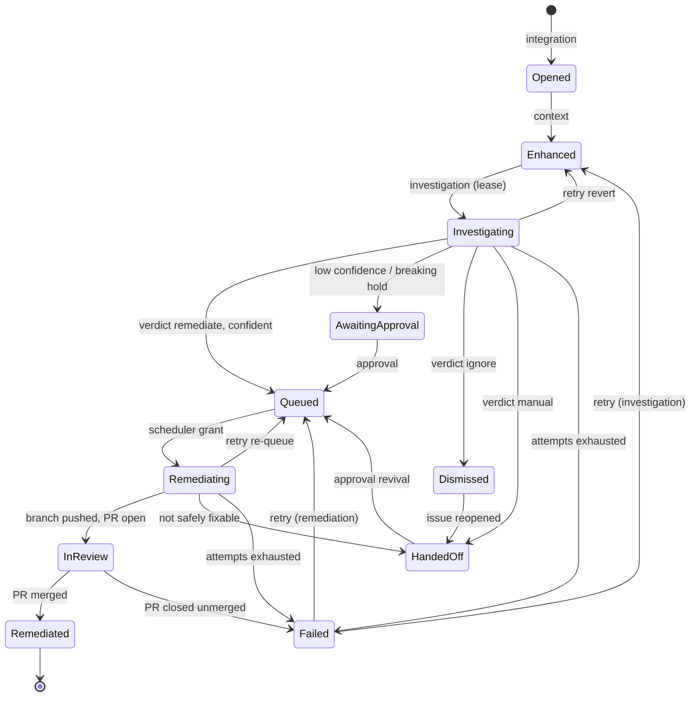

# Finding lifecycle

The `Finding` custom resource is the authoritative state machine for one security finding. `api/v1alpha1` defines the
phases and the table of legal transitions (`transitions.go`). `SetPhase` refuses an illegal move, so a controller cannot
invent a transition by accident. This page is the one reference for phases, verdict routing, retry and expedite. Other
pages link here instead of repeating it. Labels on the tracking issue are a one-way projection of this state. See
[Issue labels](issue-labels.md).

## Phases

On the happy path, `Finding.status.phase` moves through
`Opened → Enhanced → Investigating → Queued → Remediating → InReview → Remediated`. `AwaitingApproval` comes before
`Queued` when a human must approve. `Dismissed`, `HandedOff` and `Failed` are the other terminal phases. `Queued` is a
real phase. Remediation runs in priority order with a limit on how many run at once, so you can see findings waiting for
a slot. The colours match the status page: amber needs a person, red has failed, and soil marks a new finding or one
closed without a change.

| Phase                                                        | Meaning                                                                                                       |
| ------------------------------------------------------------ | ------------------------------------------------------------------------------------------------------------- |
| <span class="pt-pill pt-pill--soil">Opened</span>            | Ingested from the first alert; accumulating, awaiting enhancement                                             |
| <span class="pt-pill pt-pill--seedling">Enhanced</span>      | The enhancer chain ran; ownership and infrastructure context recorded                                         |
| <span class="pt-pill pt-pill--seedling">Investigating</span> | An `Investigation` child exists (creating the child is the lease); the analysis Job runs                      |
| <span class="pt-pill pt-pill--amber">AwaitingApproval</span> | Verdict is `remediate` but below the confidence threshold, or held for a breaking change                      |
| <span class="pt-pill pt-pill--seedling">Queued</span>        | Admitted to the remediation queue; waiting for a priority-ordered slot                                        |
| <span class="pt-pill pt-pill--seedling">Remediating</span>   | A `Remediation` child holds a slot; the remediation Job runs                                                  |
| <span class="pt-pill pt-pill--seedling">InReview</span>      | Branch pushed, pull request open; humans review                                                               |
| <span class="pt-pill">Remediated</span>                      | Pull request merged. **Terminal**                                                                             |
| <span class="pt-pill pt-pill--red">Failed</span>             | Attempts exhausted, a fatal stage outcome, or the PR closed unmerged. **Terminal**, retryable                 |
| <span class="pt-pill pt-pill--soil">Dismissed</span>         | Verdict `ignore`: alerts dismissed, issue closed. **Terminal**, revivable                                     |
| <span class="pt-pill pt-pill--amber">HandedOff</span>        | Verdict `manual`, a remediation the agent judged unsafe, or a human closed the issue. **Terminal**, revivable |

Entering a terminal phase sets `status.completedAt`, which starts the
[finding TTL](../configuration/remediation-controller.md). The TTL is 14 days by default, and the `FindingRollup`
objects keep the statistics after deletion. A finding can leave every terminal phase except `Remediated`. Leaving clears
`completedAt` and cancels the TTL:

- **Dismissed → HandedOff** when someone reopens the tracking issue.
- **HandedOff → Queued** on an approval newer than the finding's completion.
- **Failed → Enhanced** or **Failed → Queued** on a human [retry](#retry).

## Verdict routing

When the analysis Job completes, the investigation-controller writes the summary to `Finding.status.investigation`. It
works out the 0–100 scheduling priority from the ratings, and routes the finding by its verdict:

| Verdict                                                           | Finding moves to                                                        |
| ----------------------------------------------------------------- | ----------------------------------------------------------------------- |
| `ignore` (false positive)                                         | `Dismissed`: the accumulated alerts are dismissed and the issue closed  |
| `manual`                                                          | `HandedOff`: the repository owners take over; an approval can revive it |
| `remediate`, confidence below the threshold, or a breaking change | `AwaitingApproval`                                                      |
| `remediate`, confidence at or above the threshold (0.75)          | `Queued`                                                                |
| Stage outcome not `ok`                                            | `Enhanced` to retry while attempts remain, then `Failed`                |

A partial report is never trusted. The outcomes other than `ok` (`runtime_error`, `timeout`, `budget_exceeded`,
`report_missing`, `report_invalid`) always retry or fail. They never route on whatever frontmatter survived. The
threshold and attempt count are investigation-controller flags. See
[investigation-controller](../configuration/investigation-controller.md).

## Legal transitions

A move to the same phase is always legal and does nothing. `SetPhase` refuses every move not shown below.



Every non-terminal phase also has an edge to `HandedOff`, written by the integration-controller when a human closes the
tracking issue. A person can always take a finding out of the machine's hands.

Each controller owns its own edges. Grouped by writer:

### integration-controller

| From             | To           | Trigger                                            |
| ---------------- | ------------ | -------------------------------------------------- |
| _(new)_          | `Opened`     | First alert of an advisory family for a repository |
| `InReview`       | `Remediated` | `pull_request` webhook: merged                     |
| `InReview`       | `Failed`     | `pull_request` webhook: closed unmerged            |
| `Dismissed`      | `HandedOff`  | A human reopened the tracking issue                |
| any non-terminal | `HandedOff`  | A human closed the tracking issue                  |

### context-controller

| From     | To         | Trigger                      |
| -------- | ---------- | ---------------------------- |
| `Opened` | `Enhanced` | The enhancer chain completed |

### investigation-controller

| From            | To                 | Trigger                                                                     |
| --------------- | ------------------ | --------------------------------------------------------------------------- |
| `Enhanced`      | `Investigating`    | The gate admits it (accumulation closed, minimum age); `Investigation` made |
| `Investigating` | `Enhanced`         | Recoverable Job failure with attempts left                                  |
| `Investigating` | `Queued`           | Verdict `remediate`, confident                                              |
| `Investigating` | `AwaitingApproval` | Verdict `remediate`, below the threshold or a breaking change               |
| `Investigating` | `Dismissed`        | Verdict `ignore`                                                            |
| `Investigating` | `HandedOff`        | Verdict `manual`                                                            |
| `Investigating` | `Failed`           | Attempts exhausted                                                          |
| `Failed`        | `Enhanced`         | Human retry of a failed investigation                                       |

### remediation-controller

| From               | To            | Trigger                                       |
| ------------------ | ------------- | --------------------------------------------- |
| `AwaitingApproval` | `Queued`      | `spec.approval` accepted                      |
| `HandedOff`        | `Queued`      | `spec.approval` newer than the completion     |
| `Failed`           | `Queued`      | Human retry of a failed remediation or review |
| `Queued`           | `Remediating` | The priority scheduler grants a slot          |
| `Remediating`      | `Queued`      | Recoverable failure, re-queued                |
| `Remediating`      | `InReview`    | Branch pushed, pull request opened            |
| `Remediating`      | `HandedOff`   | The agent reports no safe fix                 |
| `Remediating`      | `Failed`      | Attempts exhausted                            |

Each trigger has one writer. `HandedOff` is the only phase with several writers. A stage's own verdict moves a finding
there from the controller that ran the stage. A human closing the issue moves it there from the integration-controller.

## Human actions

People act on a finding by writing its **spec**, never its status. The controller that owns the matching edge sees the
change and makes the transition. So the edge keeps its one writer, whichever tool the human used: the `/approve` issue
comment, the [status page](../operate/status-page.md), or the [patchy CLI](../operate/cli.md). Each action is a custom
RBAC verb on `findings.patchy.bitwisemedia.uk`.

| Action   | Spec field      | Available when                    | Effect                                                                |
| -------- | --------------- | --------------------------------- | --------------------------------------------------------------------- |
| Approve  | `spec.approval` | `AwaitingApproval` or `HandedOff` | Releases the hold, or revives a handed-off finding into the queue     |
| Retry    | `spec.retry`    | `Failed`                          | Recovers the finding to the state it failed from                      |
| Expedite | `spec.expedite` | any phase up to `Queued`          | Skips the waiting stages and jumps both queues for the finding's life |
| Suspend  | `spec.suspend`  | any non-terminal phase            | Pauses pipeline progress until cleared                                |
| Resume   | `spec.suspend`  | a suspended finding               | Lifts the pause                                                       |

### Approve

An `/approve` comment on the tracking issue, the status page's **Approve** button and `patchy approve` all write the
same `spec.approval` record (who, when, an optional note). The remediation-controller's spawner then drives
`AwaitingApproval → Queued`, or `HandedOff → Queued` when the approval is newer than the finding's completion. The first
approval wins, with one exception. On a handed-off finding, an approval recorded before the finding completed can never
revive it, so a new approval replaces it.

### Retry

A retry recovers a `Failed` finding to the recoverable state immediately before the failure. A failed investigation
reverts to `Enhanced`, and the investigation gate opens the next attempt. A failed remediation, or a pull request closed
without merging, re-queues to `Queued`, and the remediation spawner creates the next attempt. The recovery uses up the
retry and sets the `Retried` condition. If the finding fails again, it needs another retry.

### Expedite

Expedite marks the finding urgent for the rest of its life. The investigation gate skips the accumulation window and the
minimum-age wait. Both schedulers rank the finding's runs ahead of all work that is not expedited. Expedite does not
bypass an `AwaitingApproval` hold, which still needs Approve. A run already in progress gains nothing from it, so it is
not offered from `Remediating` onwards.

## Conditions

Facts that are not phases are stored in `status.conditions`. Accumulation is the important one. Alerts keep folding into
a Finding **while** enhancement runs, so the close of the window cannot be a phase.

| Condition              | On                                                     | Meaning                                                                                                      |
| ---------------------- | ------------------------------------------------------ | ------------------------------------------------------------------------------------------------------------ |
| `Ready`                | every kind                                             | The summary condition                                                                                        |
| `Stalled`              | every kind                                             | Cannot progress without operator action (ambiguous forge match, oversized artifact)                          |
| `AccumulationComplete` | Finding                                                | The accumulation window closed; the gate may admit                                                           |
| `ContextEnhanced`      | Finding                                                | The enhancer chain ran                                                                                       |
| `Investigated`         | Finding                                                | Analysis completed; the reason carries the verdict                                                           |
| `Approved`             | Finding                                                | A `spec.approval` was accepted                                                                               |
| `Retried`              | Finding                                                | A `spec.retry` was consumed; the message names the requester                                                 |
| `ForgeResolved`        | Finding                                                | The repository resolved to exactly one Forge (`False` reasons: `NoRepository`, `NoForgeMatch`, `Ambiguous`)  |
| `RolledUp<Scope>`      | Finding                                                | Rollup accounting, one per scope (`Total`, `Repository`, `Harness`, `Model`): exactly-once, finalizer-backed |
| `Complete`             | Investigation, Remediation, Evaluation, EvaluationUnit | The stage or unit settled; the reason carries the outcome                                                    |
| `UnitsCreated`         | Evaluation                                             | Every child `EvaluationUnit` exists                                                                          |

Findings parked with `ForgeResolved: False` are re-queued automatically when `Forge` resources change. The
[Evaluation](evaluation.md) kinds have their own local phases and are never part of the Finding transition table.

## Watching it

```sh
kubectl get findings -n patchy -w                   # phase, severity, priority, verdict, live
kubectl get investigations                          # per-attempt analysis children (short name: inv)
kubectl get remediations                            # per-attempt remediation children (rem)
kubectl get findingrollups                          # the all-time statistics (fr)
kubectl describe finding <name>                     # conditions, phase log, enrichments, attempts
kubectl get patchy -n patchy                        # every patchy kind, one shot
```

Machine metadata that used to live on issue labels (alert numbers, accumulation state, confidence, budgets, attempt
counts, per-stage token and cost accounting) lives on these resources and nowhere else.
