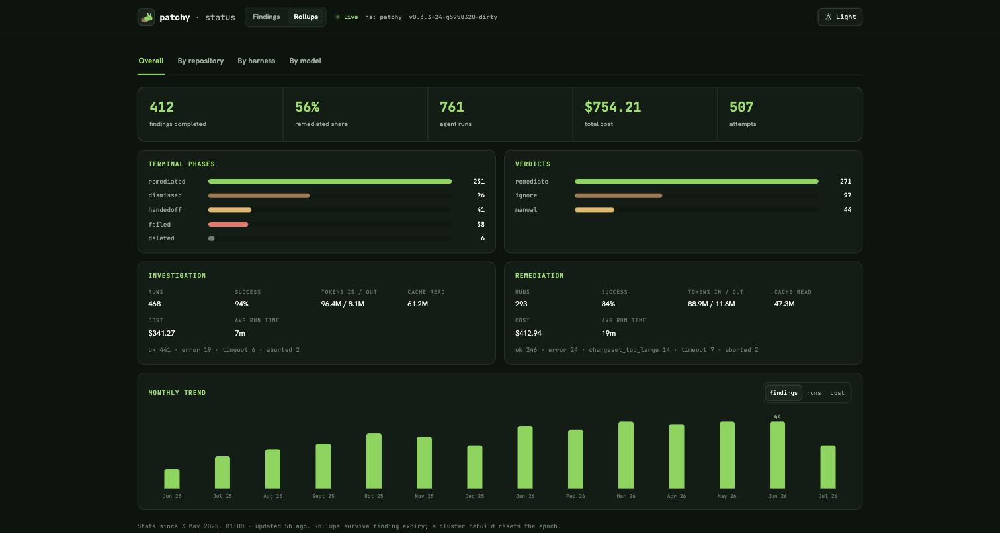

# The status page

Patchy's human surface beyond the tracking issues: a web dashboard served by the
[status-server](configuration/status-server.md) showing every `Finding` in the namespace, the two human gates
(`AwaitingApproval` holds and `HandedOff` revival), and the all-time `FindingRollup` statistics. The page is a single
embedded artifact — one self-contained HTML file compiled into the binary — with live updates: the server watches the
Finding and FindingRollup resources and nudges open browsers over Server-Sent Events to refetch.

The same findings, the same actions and the same RBAC are available from a terminal via the [patchy CLI](cli.md) — it
reads and writes the identical custom resources, so the two surfaces never disagree about state.

## Views

The screenshots below show the [canned dev data](deployment/dev-fake.md#canned-status-page-data) — every finding
deliberately suspended, hence the `suspended` pill on each row.

- **Findings** — a one-line summary of what is in progress and what needs a person (each part filters the list to it),
  the eleven-phase lifecycle rail with live counts (select a phase to filter), the same type-ahead filter as Metrics
  (free text, severity, phase, verdict and repository, each applied filter a removable chip; <kbd>/</kbd> focuses it), and
  the list: severity, phase (with a live-dot while an agent run is active and a `suspended` pill), confidence, verdict,
  and age per finding. On narrow screens rows stack and the navigation folds into a menu.

  

- **Finding detail** — the advisory header with status and severity, tabs (Overview · Alerts · Timeline · Investigation
  · Remediation), the metadata sidebar (owners, repository, source, tracking issue, advisories, dates), and the action
  bar. A completed remediation shows the merged PR; terminal states surface failure reasons, dismissal verdicts, and
  hand-off routes. The investigation and remediation tabs each end in a **Conversation** section — see
  [Agent conversations](#agent-conversations).

  

- **Metrics** — all-time statistics from the `FindingRollup` shards: how findings ended, verdict mix, per-stage
  token/cost/duration aggregates, the monthly trend, and ranked repository, model and harness tables. One filter slices
  the whole view: type to find a repository (built for organisations with tens of thousands), a model, a harness, or
  pick **All repositories matching "…"** to see the combined figures for every repository whose name contains a term.
  Press <kbd>/</kbd> to focus the filter. Each slice has its own link (`#/metrics/repository/<owner%2Frepo>`); old
  `#/rollups` links still resolve. It needs `get` on `findingrollups`.

  

- **Configuration** — one page that opens with a health summary (anything not ready, failing or in conflict is listed
  and links to its card) and the flow from integrations to enhancers to forges, then the namespace's configured
  Integrations, Forges, and derived context enhancers: provider, capabilities,
  credential Secret names (names only, never contents), readiness, the failed-delivery sweep's last outcome, and the
  [manual backfill](integrations/sources/github.md#the-manual-backfill) trigger with its last run's report. The nav link
  renders only for users granted `get` on `integrations` — and it is
  read-only apart from the backfill trigger: the resources themselves are managed in the cluster.

## Agent conversations

Each run's investigation and remediation tab carries the agent's turn-by-turn conversation: its messages, its reasoning,
every tool it called and what came back. While a run is in flight the section streams live; afterwards it replays the
stored record.

What makes that possible is that the agent pod normalises its own CLI's output — claude's content blocks and codex's
items both become the same turn vocabulary — and emits it on stdout under a `PATCHY-TURN:` prefix, alongside the
`PATCHY-EVENT:` stage result. The owning controller reads that log once when the Job finishes and writes the
conversation to a ConfigMap owner-referenced to the run. Since a run is owned by its Finding, the
[finding TTL](configuration/remediation-controller.md) cascade deletes the transcript with everything else: a
conversation is retained exactly as long as the finding it explains, and no longer.

A few behaviours are worth knowing:

- **The live stream is the whole conversation; the stored record is a summary.** While a run is in flight the page shows
  every turn: there is no turn cap, a single turn is capped at 64 KiB, and the run as a whole at 8 MiB (a safety valve —
  the kubelet rotates a container log at 10 MiB, and the stage result must stay readable after it). When the run is
  collected, the controller compacts what it streamed to fit its ConfigMap: at most 500 turns of at most 2 KiB each and
  512 KiB in total, keeping the start and the end of the conversation with one "N turns elided from stored record"
  notice between them. Any value matching a credential in the pod's environment is replaced with `«redacted»` before it
  leaves the pod. A conversation cut short by either bound says so, in the section footer and on the turn that was cut.
  The stream bounds are `PATCHY_TRANSCRIPT_MAX_TURN_BYTES`, `PATCHY_TRANSCRIPT_MAX_TURNS` (`0`, the default, is
  unbounded) and `PATCHY_TRANSCRIPT_MAX_TOTAL_BYTES`; the stored bounds are fixed.
- **Tool calls keep their body.** An edit shows as a diff, a file write shows its content, and a shell command shows the
  command, each syntax-highlighted; a file read is highlighted by the file's language, with its line numbers in a
  gutter. Fenced code blocks in the agent's prose, the report and the finding description are highlighted too.
- **A dropped connection resumes.** Every turn carries its sequence number as the event id, so a viewer that reconnects
  — or that fell too far behind the live stream and was told to — picks up after the last turn it saw, without a gap and
  without repeating the conversation.
- **The upstream session id is not a handle.** `stage.sessionID` records what the agent CLI called its session, which is
  useful for correlating against model-provider logs — but it resolves only against a session file in the pod's `$HOME`,
  which is an `emptyDir` that dies with the pod. Nothing can fetch a conversation from the provider after the fact,
  which is why patchy stores it.

Live streaming needs the status server to read pod logs in the agent namespace, through the API server — it never dials
an agent pod, so the agents' default-deny ingress policy is untouched. Turn it off with
`statusServer.liveTranscripts=false` (helm) or by dropping the `patchy-status-server-agent-logs` Role and its binding
(kustomize); completed runs' conversations still serve, since those come from their own ConfigMaps.

## Actions and what they really do

The action bar renders only the verbs the signed-in user is granted _and_ the finding's state machine allows:

| Action       | Available when                    | What the server writes                                          |
| ------------ | --------------------------------- | --------------------------------------------------------------- |
| **Approve**  | `AwaitingApproval` or `HandedOff` | `spec.approval` — the same record the `/approve` comment writes |
| **Retry**    | `Failed`                          | `spec.retry` — a recovery request                               |
| **Expedite** | any phase up to `Queued`          | `spec.expedite` — a standing urgency mark                       |
| **Suspend**  | any non-terminal phase            | `spec.suspend: true`                                            |
| **Resume**   | a suspended finding               | `spec.suspend: false`                                           |

One action lives on Integrations rather than findings — the configuration view's backfill trigger:

| Action       | Available when                                       | What the server writes             |
| ------------ | ---------------------------------------------------- | ---------------------------------- |
| **Backfill** | a github Integration with code scanning, unsuspended | `spec.backfill` on the Integration |

The status server never moves a phase. Approving records the approval; the remediation-controller's spawner then drives
`AwaitingApproval → Queued` (or revives `HandedOff → Queued` when the approval is newer than the finding's completion)
exactly as it does for a `/approve` issue comment — the state machine's one-writer-per-edge rule holds no matter which
surface the human used.

**Retry** recovers a `Failed` finding to the state immediately before the failure: a failed investigation reverts to
`Enhanced` (the gate opens the next attempt), a failed remediation — or a pull request closed without merging — re-
queues to `Queued` (the spawner creates the next attempt). Each edge keeps its single writer: the investigation gate
drives `Failed → Enhanced`, the remediation spawner `Failed → Queued`. A retry is consumed by the recovery itself; if
the finding fails again, another retry is required.

**Expedite** marks the finding urgent for its whole lifetime: the investigation gate skips the accumulation window and
minimum-age wait, and both schedulers rank the finding's runs ahead of all non-expedited work. It does not bypass an
`AwaitingApproval` hold — that remains approve's job.

## The user menu

The signed-in name in the top bar drops a menu holding sign-out and two demo actions — **Replay deliveries** (RBAC verb
`replay`) and **Reset all data** (verb `reset`), both custom verbs on `integrations.patchy.bitwisemedia.uk` — each
hidden without its grant. Together they re-run the entire pipeline from ingestion; what they write and when to grant
them is covered in [Demo tooling](deployment/dev-fake.md#the-demo-loop-replay-and-reset).

## Access model

Two tiers, on purpose:

1. **Nothing is public.** Without an [auth configuration](configuration/status-server.md) the page shows "sign-in is
   not configured" and no data leaves the cluster. Auth mode `none` is the one exception — authentication explicitly
   disabled, everything open (development only).
2. **Every view requires sign-in + RBAC.** Metrics need `get` on `findingrollups` — repository names and per-repository
   spend are not for anyone who can reach the page. A signed-in user sees findings
   only if RBAC grants `get` on `findings`, and each action button only with the matching custom verb (`approve` /
   `retry` / `expedite` / `suspend` / `resume` on `findings.patchy.bitwisemedia.uk`). The configuration view has its own
   gate — native `get` on `integrations` — and its backfill trigger its own verb (`backfill` on
   `integrations.patchy.bitwisemedia.uk`, beside `replay` and `reset`). Agent conversations are finding content and ride
   the same `get findings` gate. The change-notification stream (`/events`) carries no content, only the fact that
   something changed, but needs any one of the read grants:

```yaml
rules:
  - apiGroups: [patchy.bitwisemedia.uk]
    resources: [findings, findingrollups]
    verbs: [get, list]
  - apiGroups: [patchy.bitwisemedia.uk]
    resources: [findings]
    verbs: [approve] # this user gets the Approve button, nothing else
```

Bind roles like this to the values of the OIDC `username`/`groups` claims (RoleBindings in the patchy namespace; grants
apply uniformly across its findings). Ready-made viewer / approver / operator / admin tiers ship in
`deploy/kustomize/base/rbac.users.example.yaml`, and the helm chart renders them with
`statusServer.rbac.userRoles=true`.

## Exposing the page

The Service is `patchy-status-server:8080`. Front it with your Ingress or Gateway on its **own hostname** — keeping it
apart from the webhook endpoint separates human authn from HMAC-signed machine traffic (helm: `statusServer.host` +
`statusServer.ingress` / `statusServer.httpRoute`). For a quick look without any exposure:

```sh
kubectl -n patchy port-forward svc/patchy-status-server 8080:8080
# → http://localhost:8080  (with the dev overlay's `mode: none` auth: full access)
```

Want the page populated without running the pipeline? The dev overlay ships
[canned data](deployment/dev-fake.md#canned-status-page-data) — one finding per lifecycle phase plus rollup statistics.
