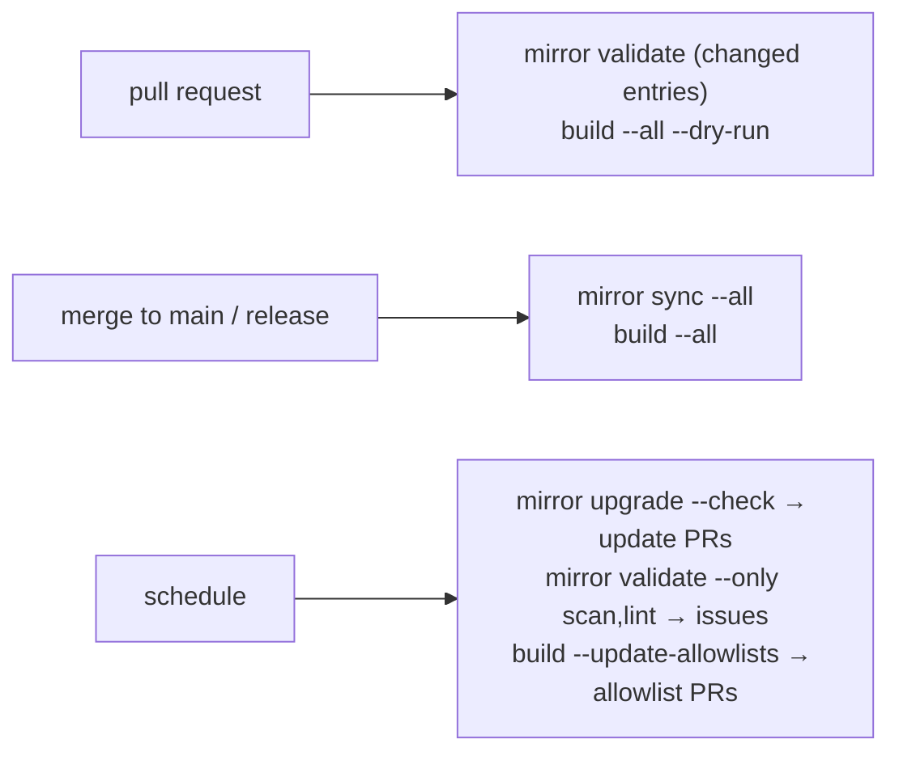

# Supply chain

`patchy` carries two cluster-free command groups that turn what a platform runs into signed OCI artifacts in your own
registries:

- **[`patchy mirror`](mirror.md)** brings in what you did not write. Upstream helm charts, the images they deploy and
  standalone OCI artifacts are vendored into a git tree for review, pinned by digest, checked against their publisher's
  signatures, scanned, and then copied into your registries signed with your own identity.
- **[`patchy build`](build.md)** publishes what you did write. Dockerfile images and Flux manifest directories are built
  and scanned **before** anything is pushed, then published and signed the same way.

Both stop at the registry. Neither touches a cluster and neither runs git: commits, branches and pull requests belong to
the pipeline that calls them. Both read the same [patchy configuration](../cli.md#configuration) for where to publish,
how to sign and which [scan policy](scanning.md) applies, so a mirrored chart and a first-party image are held to one
standard. Each can also be limited to [approved sources](source-policy.md).

|            | `patchy mirror`                                                                                         | `patchy build`                                                                        |
| ---------- | ------------------------------------------------------------------------------------------------------- | ------------------------------------------------------------------------------------- |
| Input      | `charts/<name>/manifest.yaml`, `artifacts/<name>/manifest.yaml`                                         | the config's `build.images` and `build.manifests`                                     |
| Committed  | the manifest, plus everything derived from it: vendored chart, rendered output, digest locks, allowlist | the Dockerfiles and manifest trees themselves, plus `security/allowlists/<name>.yaml` |
| Gate       | `validate`: regenerate and byte-compare, verify provenance, scan, lint                                  | `--dry-run`: build and scan without a registry                                        |
| Publish    | `sync`: copy charts and images by digest, sign                                                          | `build`: push every tag, sign                                                         |
| Moves pins | `upgrade` (the only verb that consults the clock)                                                       | never: you choose the tags                                                            |

## The pipeline

Both groups fit the same three-trigger shape. The pull request gate proves the change is safe without credentials, the
merge publishes it, and a schedule notices what changed upstream or in the vulnerability databases since.



Every verb that reports has `-o markdown`, which is written to be pasted as-is into a job summary, a sticky PR comment
or an issue body. `-o json` is the same report as data. The exit code is always the gate, so a workflow never has to
parse the output to decide whether to fail.

## Registries

`registries` lists every registry an artifact is published to. Every mirror entry and every build entry goes to all of
them. `--registry` narrows a single run (`patchy mirror sync --all --registry ghcr`).

```yaml
registries:
  - name: google # keys the lock files' targets and --registry
    url: us-central1-docker.pkg.dev/acme-platform/platform
    chartNamespace: charts # mirror: where charts land under the url (default charts)
    imageNamespace: images # mirror: images land at images/<canonical source path>
    artifactNamespace: artifacts # mirror: artifacts land at artifacts/<canonical source path>
  - name: aws
    url: 123456789012.dkr.ecr.eu-west-1.amazonaws.com/platform
    signing: # optional: replaces the top-level signing block for this registry
      provider: kms
      kms:
        key: awskms:///arn:aws:kms:eu-west-1:123456789012:alias/platform-signing
```

The namespaces only apply to mirrored content. A build entry names its own `repository`, which is published at
`<url>/<repository>:<tag>`. Authentication is the docker keychain: log in to each registry host (`docker login`,
`crane auth login`, or a cloud credential helper) before running `sync` or `build`. patchy, cosign and buildx all read
it.

## Signing

Everything published is signed with [cosign](https://github.com/sigstore/cosign), and the signature is stored as a
sigstore bundle attached through the OCI referrers API. Older ECR private registries without referrers support fall back
to cosign's tag-based scheme. The top-level `signing` block is the default, and a registry's own `signing` block
replaces it wholesale for pushes to that registry.

```yaml
signing:
  provider: keyless # keyless | kms
  keyless:
    certificateIdentity: https://github.com/acme/platform-mirror/.github/workflows/publish.yaml@refs/heads/main
    certificateOidcIssuer: https://token.actions.githubusercontent.com
    tlogUpload: true # public transparency log entry; turn off for private repositories
  # kms:
  #   key: gcpkms://projects/<p>/locations/<l>/keyRings/<r>/cryptoKeys/<k>
```

- **keyless** signs with the run's ambient OIDC identity: in GitHub Actions, the workflow's `id-token: write` token
  becomes a short-lived Fulcio certificate whose subject is the workflow file at its ref. `certificateIdentity` is the
  subject patchy **verifies** against before signing. A digest that already carries a valid signature with that identity
  is not signed again, which keeps re-runs quiet. A digest signed under another identity (an edge workflow versus a
  release workflow, say) is simply signed again; the extra signature is harmless.
- **kms** signs with a cloud KMS key (`gcpkms://`, `awskms://`, `azurekms://`, `hashivault://`). Which key schemes work
  is decided by the installed cosign build.

Publishing needs `cosign` v3 or later on `PATH`. Signing is recursive for an image index, so every platform manifest is
signed too.

## Consuming what you publish

The artifacts are ordinary OCI artifacts, so anything that speaks OCI can pull them. Verify them the way you configured
them to be signed:

```sh
cosign verify us-central1-docker.pkg.dev/acme-platform/platform/charts/cert-manager:v1.21.2 \
  --certificate-identity https://github.com/acme/platform-mirror/.github/workflows/publish.yaml@refs/heads/main \
  --certificate-oidc-issuer https://token.actions.githubusercontent.com
```

A Flux `OCIRepository`, or a `HelmChart` pulled from an OCI `HelmRepository` for a mirrored chart, does the same check
on every reconcile with its `verify` block. Pin the identity with `matchOIDCIdentity`, using a subject regexp when
several workflows publish to the same repository:

```yaml
apiVersion: source.toolkit.fluxcd.io/v1
kind: OCIRepository
metadata:
  name: platform
  namespace: flux-system
spec:
  url: oci://us-central1-docker.pkg.dev/acme-platform/platform/manifests/platform
  ref:
    semver: ">=0.0.0"
  verify:
    provider: cosign
    matchOIDCIdentity:
      - issuer: ^https://token\.actions\.githubusercontent\.com$
        subject: ^https://github\.com/acme/platform-manifests/\.github/workflows/publish(-edge)?\.yaml@refs/.+$
```

## What you need installed

patchy links nothing it shells out to, so these must be on `PATH` for the verbs that use them:

| Tool                 | Needed by                                                                                                                            |
| -------------------- | ------------------------------------------------------------------------------------------------------------------------------------ |
| `cosign` v3+         | `mirror validate` (provenance verification), `mirror sync` (provenance verification and signing), `build` (signing; not `--dry-run`) |
| `osv-scanner` v2     | image scans when `scan.scanners.osv.enabled`                                                                                         |
| `grype`              | image scans when `scan.scanners.grype.enabled`                                                                                       |
| `kubescape`          | configuration scans when `scan.scanners.kubescape.enabled`; skipped with a warning when missing                                      |
| `docker` with buildx | `build` of image entries (not needed for manifests entries)                                                                          |

Helm is not needed: chart pulls, renders and pushes use the helm SDK, pinned so rendered output stays byte-stable.

!!! tip "Repositories on the shared toolchain"

    A repository on the bitwise-media-group [toolchain](https://oss.bitwisemedia.uk/toolchain/) gets all of this from
    the **containers** archetype: pinned patchy, cosign, scanners and Flux validation tools, plus mise tasks over these
    commands. `mise run build` runs `patchy build --all --dry-run`, `mise run publish` publishes, and the `mirror-*`
    tasks drive a mirror store. Before each `patchy build`, the tasks set `GIT_COMMIT`, `VERSION` and
    `SOURCE_DATE_EPOCH` from git, so tag templates expand the same way locally and in CI. See the
    [containers archetype](https://oss.bitwisemedia.uk/toolchain/archetypes/containers/).
